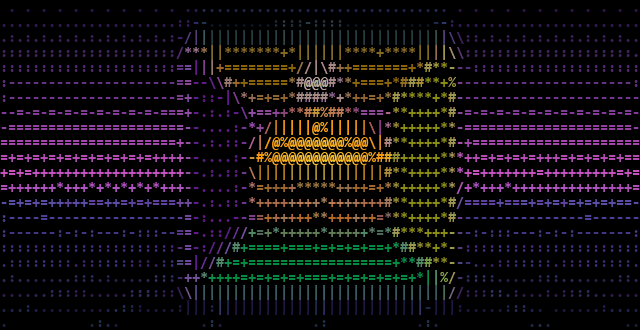

# ascii-motion

<div align="center">

**A high-performance, cross-platform video-to-ASCII rendering engine with a scriptable CLI and an interactive local Web Studio.**

[](https://github.com/rajveersinh-is-dev/ascii-motion/actions/workflows/ci.yml)
[](LICENSE)
[](pyproject.toml)
[](tests/)
[](docs/BENCHMARKS.md)

<br />

<!-- Genuine software-rendered demonstration asset -->


*Real, unadulterated software output generated directly by `ascii-motion` from a synthetic 640x360 source video.*

</div>

---

## Highlights

- **Vectorized High-Throughput Core**: Core luminance conversion runs at **400 to 700+ FPS** across resolution presets via pure NumPy broadcasting and array slicing.
- **Aspect-Ratio Correction**: Compensates for non-square monospace character cell geometry ($\approx 1:2$ width-to-height ratio) so circular geometry and facial proportions remain accurate.
- **Perceptually Informed Luminance**: Colorimetric mapping using ITU-R BT.709 (sRGB/HDTV) and BT.601 coefficients rather than naive RGB averaging.
- **Multiple Visual Styles**: TrueColor RGB, classic monochrome, retro green phosphor (`#33FF33`), retro amber phosphor (`#FFB000`), and custom foreground/background palettes.
- **Advanced Visual Quality**:
  - **Dynamic Bayer Dithering**: Recursively generated ordered dither matrices from first principles.
  - **Floyd-Steinberg Error Diffusion**: Classical 2D quantization error distribution.
  - **Sobel Edge Enhancement**: Vectorized $3 \times 3$ gradient convolution with directional ASCII edge strokes (`-`, `|`, `/`, `\`).
  - **Adaptive Temporal Stabilization**: Motion-decay exponential smoothing to suppress background flicker while preserving dynamic motion.
- **Two First-Class Interfaces**:
  1. **Scriptable CLI**: Clean arguments, progress indicators, config file support, and machine-readable JSON reports.
  2. **Local Web Studio**: Modern dark creative-tool SPA (React 18 + TypeScript + Vite) with drag-and-drop upload, live interactive HTML5 canvas preview, and background job coordination.
- **Multi-Format Exports**:
  - Live flicker-free ANSI terminal playback.
  - Standalone single-file HTML5 animation player (100% offline, zero CDN dependencies).
  - Rendered H.264 MP4 video with audio passthrough.
  - Animated GIF and plain text / ANSI sequences (`.txt`, `.ans`).

---

## Architecture Overview

```
                          ┌─────────────────────────────┐
                          │     Input Video Source      │
                          │   (MP4, MOV, WebM, AVI)     │
                          └──────────────┬──────────────┘
                                         │
                                         ▼
                          ┌─────────────────────────────┐
                          │   VideoStreamReader (C/FFmpeg)
                          │   - Stream-level Downscaling│
                          │   - Memory-bounded RGB pipe │
                          └──────────────┬──────────────┘
                                         │
                                         ▼
                          ┌─────────────────────────────┐
                          │  FrameConverter Core Engine │
                          │   - BT.709 Perceptual Lum   │
                          │   - Tone Mapping & Gamma    │
                          │   - Bayer / Floyd-Steinberg │
                          │   - Vectorized Char Lookup  │
                          └──────────────┬──────────────┘
                                         │
                  ┌──────────────────────┼──────────────────────┐
                  │                      │                      │
                  ▼                      ▼                      ▼
        ┌──────────────────┐   ┌──────────────────┐   ┌──────────────────┐
        │ Terminal Output  │   │  HTML5 Animation │   │ Video Exporter   │
        │ - 24-bit ANSI    │   │ - Standalone JS  │   │ - H.264 MP4      │
        │ - Cursor pacing  │   │ - HTML5 Canvas   │   │ - Animated GIF   │
        └──────────────────┘   └──────────────────┘   └──────────────────┘
```

For in-depth architectural details and component boundaries, see [docs/ARCHITECTURE.md](docs/ARCHITECTURE.md).

---

## Installation & Prerequisites

### Prerequisites
- Python 3.10 or later
- Node.js 18+ and npm (for the web studio)
- FFmpeg (automatically detected via system PATH, `imageio-ffmpeg`, or `ASCII_MOTION_FFMPEG_PATH`)

### Quick Setup

```bash
# 1. Clone repository
git clone https://github.com/rajveersinh-is-dev/ascii-motion.git
cd ascii-motion

# 2. Set up virtual environment
python -m venv .venv

# Activate on Windows (PowerShell):
.\.venv\Scripts\Activate.ps1
# Activate on Linux / macOS:
source .venv/bin/activate

# 3. Install ascii-motion with development tools
pip install -e ".[dev]"

# 4. Build web studio frontend
cd web
npm install
npm run build
cd ..
```

---

## Quick Start: Command-Line Interface (CLI)

### Live Terminal Playback
Watch real-time paced ASCII playback directly in your terminal:
```bash
ascii-motion input.mp4 --mode terminal --preset medium --style color
```

### Export to MP4 Video with Audio Passthrough
Render ASCII characters onto a video canvas encoded to H.264:
```bash
ascii-motion input.mp4 --output output.mp4 --preset medium --style color
```

### Generate Standalone Offline HTML Player
Create a self-contained single-file `.html` document viewable in any browser offline:
```bash
ascii-motion input.mp4 --output animation.html --preset high --style green
```

### Export Animated GIF with Block Characters
```bash
ascii-motion input.mp4 --output demo.gif --ramp blocks --fps 15
```

### Reproducible Configuration & Machine-Readable Reports
```bash
# Save active parameters to JSON config
ascii-motion input.mp4 --save-config settings.json --preset high --contrast 1.2

# Run with config and export detailed performance report
ascii-motion input.mp4 -c settings.json --output render.mp4 --report metrics.json
```

---

## Quick Start: Interactive Local Web Studio

Launch the local web application:
```bash
python -m ascii_motion.api.app
```
Then navigate to `http://localhost:8000` in your browser.

### Web Studio Capabilities
1. **Video Ingestion**: Drag-and-drop any video or click **"Use Sample Demo Video"** to test immediately without personal media files.
2. **Interactive Viewport**: Live HTML5 canvas rendering of ASCII character cells with real-time feedback as sliders move.
3. **Timeline Scrubber**: Frame-by-frame scrub, playback loop, timecode display, and 1-click **"Copy ASCII Text"** button.
4. **Studio Settings Panel**: Instant presets (Low, Medium, High, Ultra, Custom), character ramp selectors, tone controls, dithering, and edge enhancement.
5. **Multi-Format Export Coordinator**: Background asynchronous rendering with progress percentage, cancellation, and download controls.

---

## Resolution Presets & Character Cell Geometry

| Preset | Target Width | Typical Target Height (16:9) | Total Cells | Ideal Use Case |
| :--- | :---: | :---: | :---: | :--- |
| **Low** | 60 columns | 17 rows | 1,020 | Compact terminal windows & lightweight GIF exports |
| **Medium** | 100 columns | 28 rows | 2,800 | Balanced quality, standard terminals, general videos |
| **High** | 160 columns | 45 rows | 7,200 | High-fidelity animations & desktop web players |
| **Ultra** | 240 columns | 68 rows | 16,320 | Extreme fine-detail rendering & 4K display monitors |
| **Custom** | 10–400 cols | Auto or explicit rows | Variable | Precise dimension targeting |

---

## Benchmarks & Performance Metrics

*Measured in-process on an Intel 12-core system (Windows 11, Python 3.14.6, NumPy 2.5.4) using high-resolution hardware performance counters (`time.perf_counter()`), preceded by 5 discarded warm-up runs over 15 iterations.*

### Microbenchmark Throughput (Frame Converter)

| Configuration | Dimensions | Total Cells | Mean Latency | Throughput (FPS) |
| :--- | :---: | :---: | :---: | :---: |
| **Low (60 cols, color)** | 60 x 17 | 1,020 | **1.43 ms** | **699.7 FPS** |
| **Medium (100 cols, color)** | 100 x 28 | 2,800 | **1.54 ms** | **647.5 FPS** |
| **High (160 cols, color)** | 160 x 45 | 7,200 | **2.30 ms** | **434.7 FPS** |
| **Ultra (240 cols, color)** | 240 x 68 | 16,320 | **2.31 ms** | **433.2 FPS** |
| **Medium + Bayer Dithering** | 100 x 28 | 2,800 | **1.62 ms** | **616.1 FPS** |
| **Medium + Sobel Edges** | 100 x 28 | 2,800 | **1.94 ms** | **515.1 FPS** |
| **Medium + Temporal Smoothing**| 100 x 28 | 2,800 | **1.51 ms** | **661.3 FPS** |

### End-to-End Pipeline Performance (Decode + Convert + Encode)

| Target Output Format | Input Video | Duration | Throughput | Output Size |
| :--- | :---: | :---: | :---: | :---: |
| **MP4 Video (100 cols, TrueColor)** | 640x360 @ 30 FPS | 2.0 s | **44.6 FPS** | 101.4 KB |
| **HTML Player (100 cols, TrueColor)**| 640x360 @ 30 FPS | 2.0 s | **102.4 FPS** | 1,989.4 KB |
| **MP4 Video (60 cols, Green)** | 640x360 @ 30 FPS | 2.0 s | **127.0 FPS** | 58.6 KB |

For complete benchmark methodology and hardware specifications, refer to [docs/BENCHMARKS.md](docs/BENCHMARKS.md).

---

## Testing & Quality Assurance

Run the comprehensive test suite:
```bash
# Execute unit, integration, and mathematical invariant tests
pytest -v

# Run linting and formatting verification
ruff check .
ruff format --check .

# Build and validate frontend TypeScript bundle
cd web && npm run build && cd ..
```

All 52 test cases pass with 0 errors, validating:
- Invariant: Output characters strictly originate from configured character ramp.
- Invariant: Dimension calculations preserve aspect ratio without double-scaling.
- Invariant: Tone adjustments and dithering strictly bound luminance within $[0.0, 1.0]$.
- Complete video decode, encode, and export lifecycles.

For review findings and fixes across all cycles, see [docs/QUALITY_AUDIT.md](docs/QUALITY_AUDIT.md).

---

## Regenerating Demonstration Assets

The demonstration assets included in `assets/` are 100% deterministic and reproducible:
```bash
python scripts/generate_demo.py
```
This script programmatically generates `demo_source.mp4`, executes the conversion pipeline, and exports `demo_animated.gif`, `demo_player.html`, and `demo_output.mp4`.

---

## License

This project is licensed under the [MIT License](LICENSE).
Copyright (c) 2026 Rajveersinh Pardeshi.
